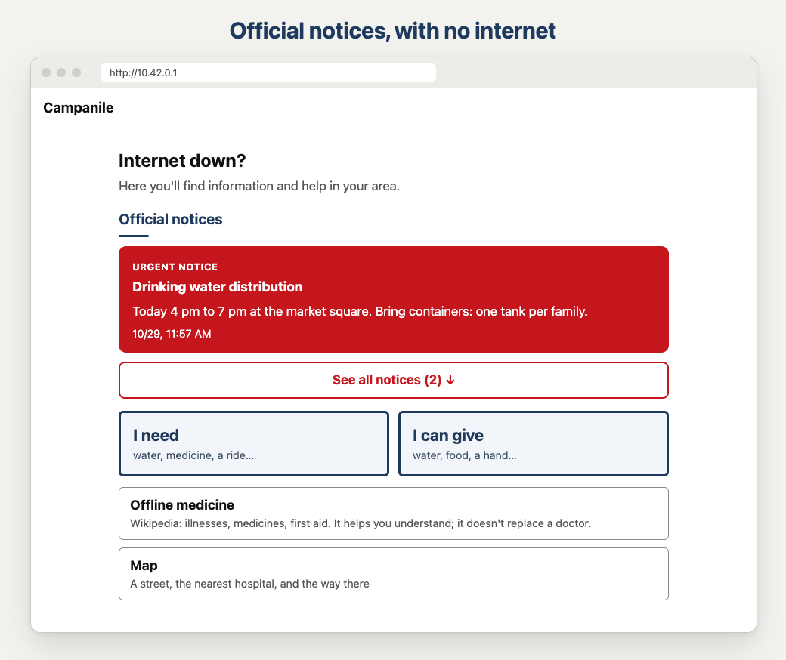

<a href="README.md">English</a> · <b>Italiano</b>

<h1>
  <picture>
    <source media="(prefers-color-scheme: dark)" srcset="docs/immagini/campanile-logo-it-bianco.svg">
    
  </picture>
</h1>

  

Un punto di informazione e di aiuto per il quartiere che funziona anche quando internet non c'è.
Per secoli le campane del campanile hanno avvisato il paese dei pericoli e chiamato tutti a
raccolta: il Campanile fa lo stesso quando la rete cade.

> [!WARNING]
> **La versione 0.1 è sperimentale.** Provata su Mac, Windows e Linux e in una prova sul campo del
> tutto senza internet; non ancora su un Raspberry Pi vero, con tanti telefoni insieme, né da un
> controllo di sicurezza esterno. Non affidarti solo a lei. I nostri limiti, detti onestamente:
> [docs/LIMITI.md](docs/LIMITI.md).

  

<em>Qui su un computer: le pagine sono pensate per il telefono e funzionano su qualunque schermo.</em>

## Cosa fa

Un portatile o un Raspberry Pi diventa una piccola rete Wi-Fi di quartiere. Chiunque si collega
con il proprio telefono, senza app, senza account e senza credito, e trova:

| | |
|---|---|
| **Avvisi ufficiali** | Chi gestisce il Campanile (Comune, protezione civile, volontari) pubblica dove si distribuisce l'acqua, dove apre un rifugio, cosa evitare. Si possono caricare anche gli allarmi ufficiali in CAP, il formato di IT-alert. |
| **Chiedo aiuto / Offro aiuto** | Acqua, cibo, medicinali, energia, alloggio, passaggi: i vicini chiedono e offrono. |
| **Sto bene** | Lasci il tuo nome per chi ti cerca, oppure cerchi una persona. |
| **Mappa offline** | La tua zona via per via. Cerchi, o tocchi **Ospedale, Farmacia, Acqua, Polizia** per i più vicini. |
| **Navigatore** | La strada per arrivarci, a piedi o in auto, evitando le strade segnate come interrotte. |
| **Medicina offline** | Le voci mediche di Wikipedia, tramite Kiwix. |
| **Piano famigliare** | Punti di ritrovo, contatti e medicinali: si compila prima e si stampa. |

Pagine in italiano e in inglese, scelte dalla lingua del telefono. Mappe di qualunque zona del mondo.

## Come si accende

**Su un portatile**, con [Python 3](https://www.python.org/downloads/):

1. Scarica il pacchetto da [Releases](https://github.com/Carrotstudiosoftwarehouse/campanile/releases) e scompattalo.
2. Doppio clic su **Avvia Campanile (Mac)** o **Avvia Campanile (Windows)**.
3. La prima volta, con internet, la pagina di preparazione scarica la mappa e le voci mediche.
4. Stampa il cartello: il suo QR apre il Campanile.
5. Tutti si collegano alla stessa Wi-Fi. Senza internet, la può fare l'hotspot di un telefono Android.

**Su un Raspberry Pi**, una stazione fissa che fa la sua Wi-Fi e apre il portale da sola:
[installare su Raspberry Pi](docs/INSTALLAZIONE.md#raspberry-pi).

**Per saperne di più:** [installazione](docs/INSTALLAZIONE.md) (mappe, Wikipedia, chiavette,
alimentazione) · [gestione](docs/GESTIONE.md) (avvisi, moderazione, avvisi firmati, allarmi
CAP, PFIF) · [navigatore ed enciclopedia](docs/FUNZIONI.md) · [sicurezza](docs/SICUREZZA.md) ·
[come è stato provato](docs/PROVE.md) · [roadmap](ROADMAP.md#italiano)

## Cosa non è

- **Non sostituisce i soccorsi.** In pericolo chiama il 112, se la rete telefonica funziona.
- **Non è riservato.** La rete è aperta: tutto ciò che si pubblica lo legge chi è collegato.
- **Non è per una città intera.** Copre un isolato, una piazza o una palestra.
- **Non è ancora al sicuro da un falso "Campanile"** con lo stesso nome della Wi-Fi: HTTPS per
  ogni Campanile è il primo problema aperto della [roadmap](ROADMAP.md#italiano).
- **È un progetto civile**, per quartieri, volontari e protezione civile: non è uno strumento per
  comunicazioni segrete o militari.

## Costruiamolo insieme

> **Vuoi dare una mano?** Stiamo costruendo una community di ingegneri, ethical hacker e persone
> comuni per provare il Campanile su dispositivi veri e portarlo in altri quartieri.
>
> Scrivi a **[info@carrotstudio.it](mailto:info@carrotstudio.it)**: raccontaci chi sei e cosa ti piacerebbe provare.

Non serve un titolo né un permesso. Una sola regola: deve essere abbastanza semplice per i nostri
genitori. Se per usare il Campanile serve un ingegnere, non abbiamo finito.

- **Non sei tecnico?** Provalo con la famiglia o gli amici e raccontaci dove vi siete bloccati.
- **Sei tecnico?** Parti da [CONTRIBUTING.md](CONTRIBUTING.md) e da ciò che non abbiamo ancora
  potuto provare, in [docs/LIMITI.md](docs/LIMITI.md).
- **Ti occupi di sicurezza?** Prova a romperlo, e segnalacelo in privato: [SECURITY.md](SECURITY.md).

Come un estintore: lo prepari con calma e speri di non usarlo mai.

## Progetti amici

Piccoli progetti con la stessa idea: aiutare le persone quando internet non c'è. Ognuno è dei suoi
autori; li colleghiamo perché insieme arrivano più lontano. Hai costruito qualcosa di simile?
Scrivicelo, e lo aggiungiamo qui.

- **[OFFGRID](https://github.com/lyle-leif/OFFGRID)**: una mappa offline e un assistente IA che
  gira su un portatile, per Batangas, nelle Filippine.
- **[Prometheus Station](https://github.com/Guillain-RDCDE/Prometheus-Station)**: una scatola a
  batteria che serve tutta Wikipedia senza internet e senza rete.
- **[ConnectBox](https://github.com/ConnectBox/connectbox-pi)**: un Raspberry Pi che condivide
  contenuti offline. Il loro [portale offline](https://github.com/ConnectBox/simple-offline-captive-portal)
  ci ha insegnato come si comportano i telefoni Android su una Wi-Fi senza internet.
- **[PirateBox](https://github.com/teklynk/piratebox)**: un Raspberry Pi che diventa un punto Wi-Fi
  offline e anonimo per scambiarsi file, tornato a nuova vita.
- **[MeshBoard](https://github.com/VeggieVampire/MeshBoard)**: una bacheca che viaggia sulle radio
  Meshtastic.
- **[Algeria Fire Map](https://github.com/MoussaabBadla/algeria-fire-map)**: gli incendi in Algeria
  visti dal satellite, in tempo reale.
- **[Donde Ayudo CL](https://github.com/P1ngu-Dev/Donde-Ayudo-CL)**: una mappa offline dei punti di
  aiuto durante le emergenze in Cile.

## Come è fatto

Fatto da CarrotStudio, con l'aiuto di un assistente IA per il codice. Ogni modifica è provata, e
quello che abbiamo verificato è scritto in [docs/PROVE.md](docs/PROVE.md).

## Licenze

Codice: [MIT](LICENSE). Mappe, Wikipedia e le librerie che usiamo hanno le loro licenze: [l'elenco](docs/INSTALLAZIONE.md#licenze).
