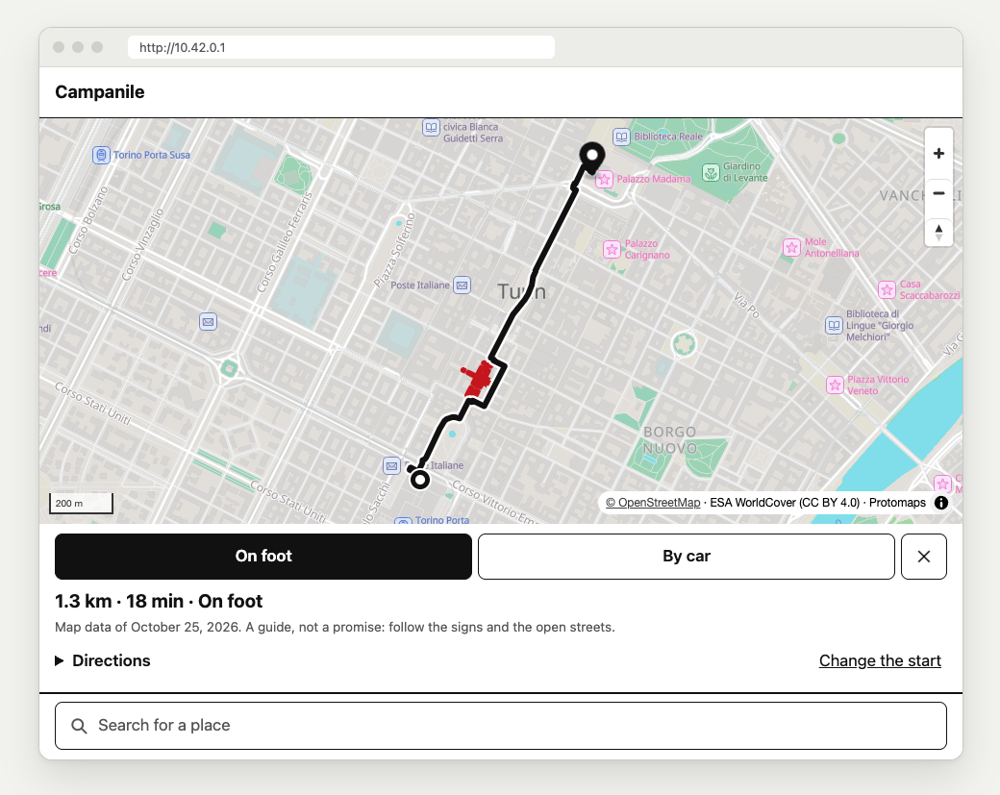
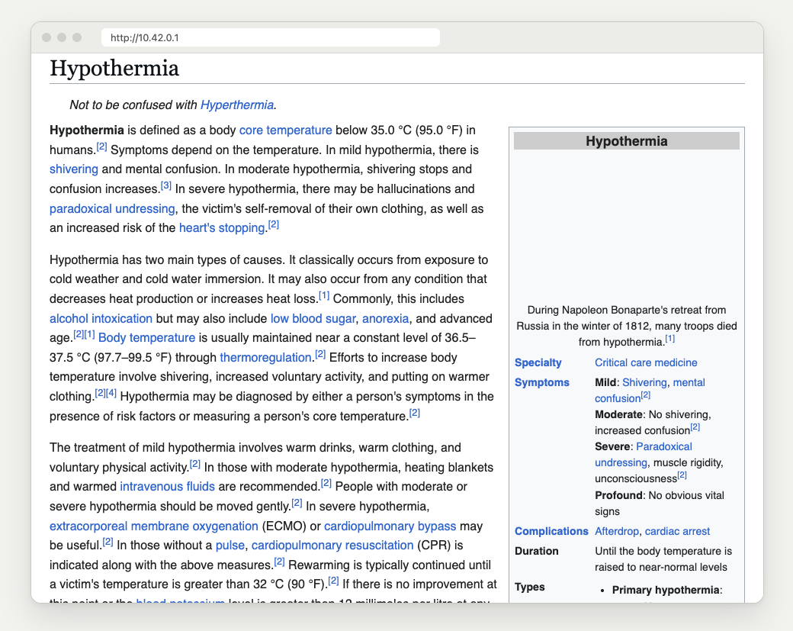

<b>English</b> · <a href="FUNZIONI.md">Italiano</a>

# The navigator and the encyclopedia

## The navigator

On the map, press **Add a destination**. Touch where you want to go (or search for it), then
where you start from. The line to follow appears, **on foot or by car**, with the distance, the
time and the turns ("Turn left onto Via Roma"). By car it keeps to one-way streets and stays off
footpaths, steps, pedestrian areas and private roads. On foot it stays off motorways.

**Blocked streets.** Whoever runs the Campanile can touch a flooded or collapsed street on the
admin page. From then on every route avoids it, and it shows in red on everyone's map. One touch
closes a place, not a single line: everything within 20 meters, and a bridge or a tunnel across
its whole width (both carriageways, the sidewalks, the other tube). If lines alongside stay open,
the admin page names them. The street stays closed after a restart, until someone reopens it.

  

**Its limits:**

- **The phone doesn't know where it is.** Browsers give the position only to HTTPS sites, and
  Campanile isn't one yet (it's on the [roadmap](../ROADMAP.md)). So you set the start by touching
  the map or searching, and the line doesn't follow you as you move.
- **It works inside the area downloaded in full detail** (your city), not between distant cities.
  The world map is too coarse.
- **A guide, not a promise.** The map data has a date, shown under the route, and streets change.
  It knows one-way streets but not turn bans, and the times are estimates. Follow the signs and
  the open streets.
- **It knows only the blocked streets someone has marked.** Any other street is open, as far as
  it can tell.

## The encyclopedia

On the home page, **Offline medicine** opens Wikipedia's medical articles (illnesses, medicines,
first aid), readable with no internet. They are served by Kiwix, the program libraries and
schools use to bring Wikipedia where there is no connection. Any other Kiwix file can be added
too, such as all of Wikipedia in any language. How to download it:
[Setting up Campanile](SETUP.md).

  

**Its limits:**

- **An encyclopedia, not a doctor.** In immediate danger call the emergency number (112 in
  Europe), if the phone network works.
- **The articles carry a date**, the day they were downloaded, and they don't update without
  internet.
