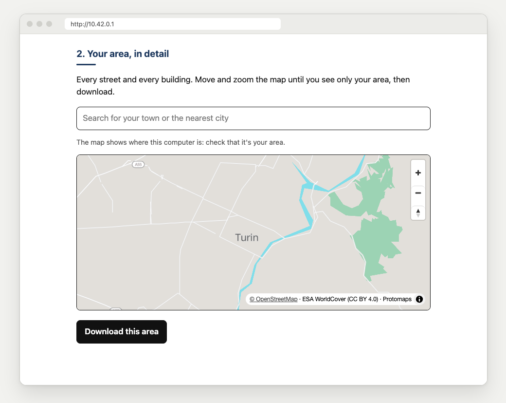

<p align="right"><b>English</b> · <a href="INSTALLAZIONE.md">Italiano</a></p>

# Setting up Campanile

Two ways to run it: on a laptop, or on a [Raspberry Pi](#raspberry-pi) as a fixed station.

## On a laptop (the simplest)

You need **Python 3**, free from [python.org](https://www.python.org/downloads/). On Windows,
tick *"Add python.exe to PATH"*. On a Mac, the developer tools it offers also work. If Python is
missing, the launcher says what to do.

1. Download the **ready-to-use package** from [Releases](https://github.com/Carrotstudiosoftwarehouse/campanile/releases) and unzip it.
2. Double-click **Avvia Campanile (Mac)** or **Avvia Campanile (Windows)** (*avvia* is Italian
   for *start*). Its window speaks the computer's language, Italian or English.
3. The **setup page** opens the first time. With internet, download the map and the medical
   articles, one click each.
4. Print the **sign** (its QR code has the address) and the one-page
   [guide](../campanile/web/guide.html) for whoever runs it.
5. Keep the black window open. Closing it turns the Campanile off.

Everyone joins **the same Wi-Fi** as the laptop. Without internet, turn on an Android phone's
**hotspot** (usually fine without SIM or mobile data) and connect the laptop and everyone to it.
*Test it first with two phones. In our test an iPhone needed mobile data, an Android did not.
Some carriers or models block it.*

> **First launch.** Answer **Allow** when macOS or Windows asks about Python's network
> connections. A Mac asks again for **kiwix-serve** (offline Wikipedia). **Allow** it too, or
> phones can't open Wikipedia.
> - Pressed *Deny* on a Mac: *System Settings → Network → Firewall → Options*.
> - Pressed *Cancel* on Windows: after a minute the black window says so, and Enter fixes it.
> - Mac won't open `Avvia Campanile (Mac).command`: *System Settings → Privacy & Security → Open Anyway*.

## Prepare it beforehand, while the internet still works

**On a laptop**, the setup page (`http://localhost:8080/setup.html`, opens by itself the first
time) downloads the world map, your area in full detail (framed on your location if the browser
can tell, or search your town) and Wikipedia's medical articles in Italian, English or both. Downloads resume
if interrupted and are checked by SHA-256 (pinned for programs, Kiwix's for Wikipedia).

<p align="center">
  
</p>

**From the terminal, or for the Raspberry**, with internet, once:

```bash
scripts/prepare.sh                        # libraries (already in the ready-to-use package)
scripts/download-map.sh italy-light       # map of Italy, ~580 MB
scripts/download-wikipedia.sh medicine    # medical articles in Italian, ~260 MB
```

| Maps (`download-map.sh`) | Size | Detail |
|---|---|---|
| `world` | ~190 MB | countries, cities and main roads of the whole world |
| `italy-light` | ~580 MB | roads across Italy |
| `italy` | ~4.5 GB | every street and building |
| `custom NAME WEST,SOUTH,EAST,NORTH` | depends | only your area, full detail |

For your own city use `custom`, anywhere in the world (read the corners from any online map).
Central Turin (`custom turin 7.64,45.04,7.71,45.09`) is about 7 MB.

| Wikipedia (`download-wikipedia.sh`) | Size in Italian |
|---|---|
| `medicine-light` (no images) | ~100 MB |
| `medicine` | ~260 MB |
| `essential` (most-read articles, no images) | ~900 MB |
| `full` (no images) | ~8.4 GB |
| `full-images` | ~30 GB |

Sizes measured on 22-24 October 2026. Other languages: add the code, as in
`scripts/download-wikipedia.sh medicine-light en` (English, no images, ~1 GB, as on the setup
page). Wikipedia starts by itself. On a laptop, first press an *Offline medicine* button on the
setup page once, to add the program that serves it.

Map search indexes each map once, in the background, into `data/places/`. It finds streets,
places and useful points (hospitals, pharmacies, drinking water...) in your area, countries and
cities in the world map.

**Then** fill in the family plan and test with a couple of phones. Print the sign early only for a
Raspberry, whose address never changes. A laptop's address changes with the network, so print its
sign (or copy the address by hand) once the day's network is up.

## More Campaniles, without internet

On the setup page, *More Campaniles*:

1. **Prepare for every computer** (with internet, once, about 250 MB) gets Wikipedia's server for
   Windows, Mac and Linux, and Python's official installers.
2. Plug in a USB stick and press **Copy to the stick** (program, maps and Wikipedia).

On the stick, double-click *Avvia Campanile*. No internet or installs needed. If Python is
missing, the window shows its installer on the stick.

- **Hand the stick over in person.** Never install a program from a Wi-Fi network: anyone can
  name one "Campanile".
- **Never on the stick:** the database (names, posts, contacts), the admin password, anything not
  on a fixed list.
- **No stowaways.** A Campanile folder already on the stick is used only if it holds nothing but
  Campanile's files. Anything else stops the copy, untouched, and links are never followed.
  Tested against every way we know to hide a program there.
- On a Raspberry, from the terminal:
  `sudo python3 /opt/campanile/campanile/copying.py /media/usb --data /var/lib/campanile --keys /etc/campanile/trusted-keys.json`

**Updating from a stick.** On the setup page, plug in a stick with a newer Campanile and press
**Update from this stick**. It is copied next to this Campanile and checked there: only a newer
version signed by CarrotStudio passes. Close the black window and open Campanile again: before
starting, it checks once more, then the new version becomes a folder of its own, "Campanile
0.2.0", and maps, Wikipedia and posts move into it. The old double click keeps working. On a
Raspberry: `sudo python3 /opt/campanile/campanile/update.py /media/USER/STICK` checks the stick the
same way, then runs the new version's installer with the choices of last time.

**Maps and Wikipedia over Wi-Fi.** On the admin page, *Share with another Campanile* shows an
address and a code. Another Campanile joins this Wi-Fi and types both on its setup page. Maps and
Wikipedia arrive, never programs. The file list is signed with the code, so a fake Campanile with
the same network name but no code is refused. Downloads are paced so phones keep their Wi-Fi, and sharing
stops after two hours.

## Keeping it powered

> **hours of runtime ≈ battery capacity in Wh × 0.8 ÷ consumption in watts**
> (power bank mAh × 3.7 ÷ 1000 = Wh)

A 20,000 mAh power bank is about 74 Wh. At 4 W, a Raspberry runs 74 × 0.8 ÷ 4 ≈ **15 hours**.
Consumption depends on the model and on how many connect, so **measure it** with a cheap USB
power meter. A foldable 20-30 W USB solar panel can recharge the power bank by day. Same rules
for a laptop, with the screen dimmed.

## Raspberry Pi

A Raspberry Pi 3B+, 4, 5 or Zero 2 W is an always-ready Campanile. It creates the open Wi-Fi
**"Campanile"**, and the portal **opens by itself** when a phone connects. It uses little power
and runs on a power bank.

You need **Raspberry Pi OS 64-bit** (Bookworm or newer: on 32-bit the map can't be downloaded on
the Pi) with built-in Wi-Fi, online **by cable** (the hotspot switches off the Wi-Fi you are on).
A Zero 2 W has no network port: use a keyboard and screen, since the hotspot is the last step, or
a USB network adapter.

```bash
sudo apt update && sudo apt install -y git
git clone https://github.com/Carrotstudiosoftwarehouse/campanile.git campanile && cd campanile
scripts/download-map.sh italy-light       # optional
scripts/download-wikipedia.sh medicine    # optional
sudo raspberry/install.sh                 # options: --ssid NAME  --country IT  --no-hotspot
```

The installer fetches the map libraries itself the first time, and waits if the Raspberry, just
switched on, is still updating itself.

`--country` is the two-letter country code for the Wi-Fi rules (for example `DE`, `FR`).

The installer:

- installs `python3`, `python3-cryptography`, `kiwix-tools` and `nginx` from Debian, and creates
  the unprivileged service user `campanile`
- puts the program in `/opt/campanile`, data in `/var/lib/campanile`, configuration in `/etc/campanile`
- puts **nginx** on port 80 for pages, maps and slow or greedy clients. The app (port 8080) and
  Wikipedia (port 8081) listen only inside the Raspberry, sandboxed by systemd, and start at boot
- creates the **open** Wi-Fi "Campanile" on `10.42.0.1` with NetworkManager, and points every
  domain name to the Campanile so phones open the portal by themselves
- isolates phones from each other. A hotspot **firewall** lets them reach only DHCP, DNS and
  Campanile, nothing else on the Raspberry or behind it

**To update**, run it again. Data and password stay. Maps added later go in
`/var/lib/campanile/maps` (readable by all, mode 644), Wikipedia files in
`/var/lib/campanile/zim` (owner `campanile`). Then `sudo systemctl restart campanile-kiwix`.

**Network changes:** the NetworkManager connection `campanile-hotspot`,
`/etc/NetworkManager/dnsmasq-shared.d/campanile.conf` (DNS redirect, only while the hotspot is
on), the firewall `/etc/campanile/firewall.nft` with its `campanile-firewall` service. It also
sets the Wi-Fi country and replaces nginx's default site (restored on uninstall).

**To remove everything:** `sudo raspberry/uninstall.sh` (keeps data and password) or
`sudo raspberry/uninstall.sh --purge` (deletes them too).

The built-in Wi-Fi serves a limited number of phones. For a whole square, use an external access
point.

## Licenses

- Campanile's code: [MIT](../LICENSE).
- Downloaded by `scripts/prepare.sh`, each under its own license (copied to
  `campanile/web/vendor/licenses/`): [MapLibre GL JS](https://maplibre.org),
  [PMTiles](https://github.com/protomaps/PMTiles) and
  [Protomaps basemaps](https://github.com/protomaps/basemaps) (BSD-3-Clause), Noto fonts
  (SIL OFL 1.1), [qrcode-generator](https://github.com/kazuhikoarase/qrcode-generator) (MIT),
  [certifi](https://github.com/certifi/python-certifi) (MPL-2.0).
- Downloaded by the setup page: [go-pmtiles](https://github.com/protomaps/go-pmtiles)
  (BSD-3-Clause), [kiwix-tools](https://github.com/kiwix/kiwix-tools) (GPL-3.0).
- Data: maps © [OpenStreetMap](https://www.openstreetmap.org/copyright) (ODbL) with ESA
  WorldCover (CC BY 4.0) via [Protomaps](https://protomaps.com). Wikipedia (CC BY-SA 4.0) via
  [Kiwix](https://kiwix.org).
